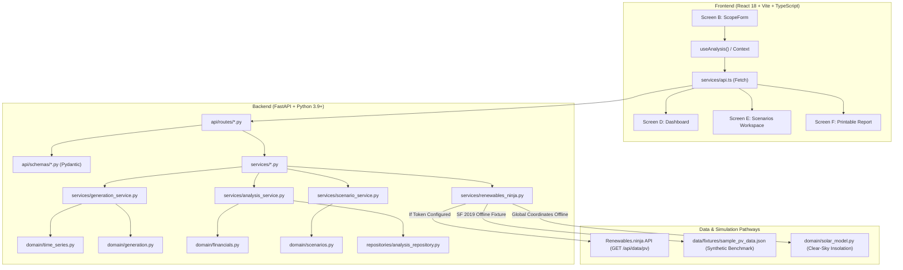

# SolarScope System Architecture

## Overview

SolarScope is an analytical solar feasibility and sensitivity-analysis platform. It is engineered with a strict separation between numerical domain logic, external data acquisition, HTTP transport, and interactive user presentation.

## Layer Responsibilities

1. **Domain Layer (`backend/app/domain/`)**:
   - Pure, stateless Python functions and frozen dataclasses.
   - Independent of FastAPI, HTTP libraries, and UI state.
   - Handles calendar arithmetic (leap year 8,784h vs non-leap 8,760h), time-series continuity, Capacity Factor arithmetic, self-consumption allocation, avoided-bill savings, simple payback, and lifetime cash flows.

2. **Integration & Service Layer (`backend/app/services/`)**:
   - `renewables_ninja.py`: HTTP client with rate-limiting backoff, timeouts, and seamless local benchmark fixture fallback.
   - `generation_service.py`: Orchestrates external retrieval, time-series validation, and monthly aggregations.
   - `analysis_service.py`: Glues generation to financial calculations and persists immutable runs.
   - `scenario_service.py`: Evaluates sensitivity adjustments against immutable baseline generation.
   - `report_service.py`: Compiles reproducible audit records with deterministic conclusions.

3. **API & Schemas (`backend/app/api/`)**:
   - Typed Pydantic request models with range validations.
   - Standardized REST endpoints:
     - `GET /api/health`
     - `POST /api/simulations`
     - `POST /api/analyses`
     - `GET /api/analyses/{id}`
     - `POST /api/analyses/{id}/scenarios`
     - `GET /api/analyses/{id}/report`

4. **Persistence (`backend/app/repositories/`)**:
   - Thread-safe in-memory store for session runs.
   - Decoupled via repository interface so SQL/Document persistence can be slotted in without modifying business rules.

5. **Client Application (`frontend/src/`)**:
   - React 18 with TypeScript.
   - Centralized `AnalysisProvider` context managing execution progress, current baseline, and scenario state.
   - Synchronized numeric sliders and inputs.
   - Recharts visualizations: monthly generation breakdown, 24-hour diurnal profile drill-down, and baseline vs scenario comparison.
   - Dedicated print stylesheet (`print.css`) for browser print-to-PDF report generation.

## Concurrency, Resource Safety & Deployment Constraints

1. **Event Loop Non-Blocking Execution**:
   - All synchronous, CPU-bound numerical operations (astronomical solar position simulation across 8,760 hours, time-series interval validation, and monthly aggregations) are executed off the main asyncio thread via `anyio.to_thread.run_sync`.
   - This ensures the FastAPI event loop remains responsive to health probes and concurrent requests.

2. **Concurrency Semaphore Guard**:
   - Simulation endpoints (`/api/analyses`, `/api/simulations`) are guarded by an `asyncio.Semaphore` configured via `settings.MAX_CONCURRENT_SIMULATIONS` (default: 20).
   - If semaphore slots are exhausted, the server rejects incoming runs immediately with HTTP 429 (`"System busy: maximum concurrent simulations reached"`).

3. **Bounded Memory Retention**:
   - `AnalysisRepository` enforces an upper limit configured via `settings.MAX_ANALYSES_CAPACITY` (default: 100).
   - Once capacity is reached, the oldest session is evicted FIFO, preventing unbound memory growth.

4. **Local-Only Deployment Classification**:
   - SolarScope is architected as an engineering workstation tool for local analysis.
   - Cross-session access control, RBAC, and multi-tenant isolation are intentionally not implemented. The system must not be exposed to public networks without reverse-proxy authentication and persistent tenant storage.
